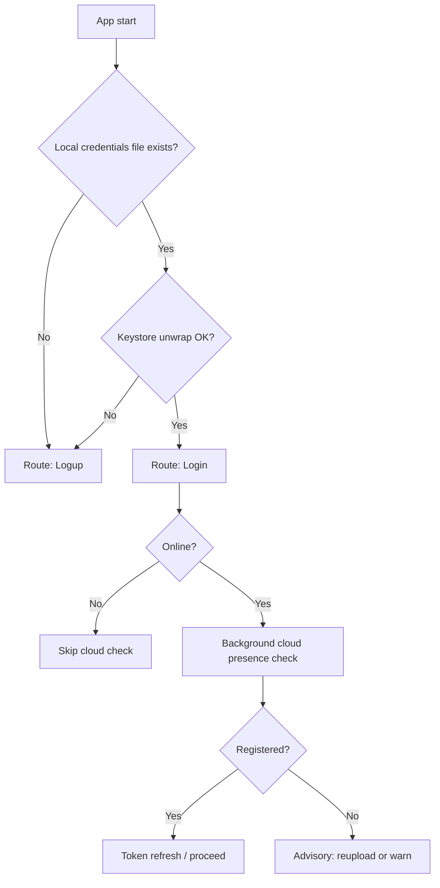
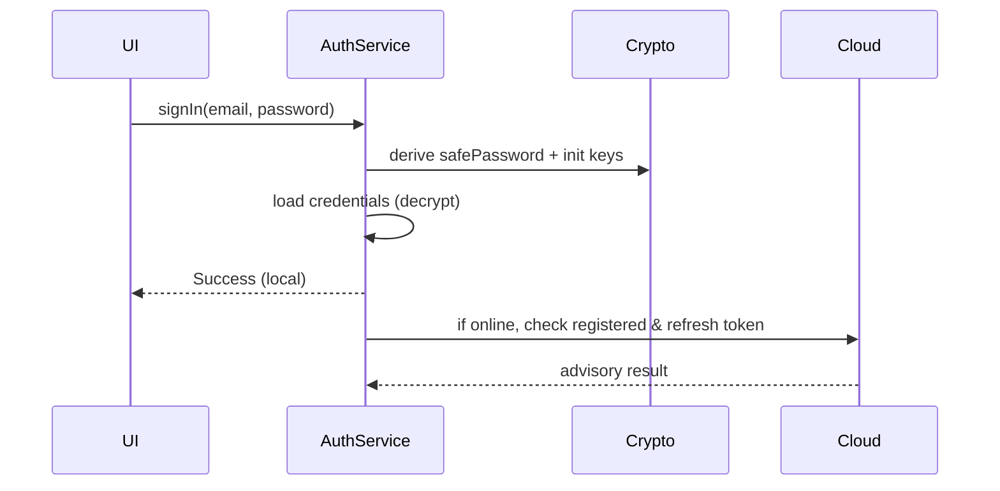

# Hybrid A+B Authentication Presence Check

Date: 2026-04-11

## Context
The current start-routing logic infers "user exists" by checking for credential files on disk. This is fast, but it treats any file presence as valid, even if the blob is corrupt, from another device, or the Android Keystore wrapper cannot unwrap it. The project intent is offline-first with optional cloud sync.

## Options Compared

### Option A — Local blob validation (Keystore unwrap)
**Idea:** Before trusting the existence of credentials, attempt to unwrap the credential blob with the Android Keystore wrapper. If unwrap fails, treat as no user.
- Pros: Offline-first, minimal change, no password required, catches corruption and device-copy cases.
- Cons: Does not confirm cloud existence.

### Option B — Cloud check when online (advisory)
**Idea:** When online, verify the user’s presence in cloud (Firebase/CloudService). Offline should still proceed.
- Pros: Stronger correctness online, aligns with cloud sync.
- Cons: Must be non-blocking to avoid breaking offline intent.

### Option C — Separate encrypted marker (HMAC or EncryptedSharedPrefs)
**Idea:** Store a small marker to quickly validate presence without loading the blob.
- Pros: Fast startup checks.
- Cons: Adds another artifact; still requires blob validation later.

## Recommendation: Hybrid A + B (Advisory Cloud)
Use **A** as the source of truth for local presence. Use **B** as a non-blocking advisory check only when network is available. This keeps the offline-first intent intact while improving correctness when online.

Key constraints:
- Never require cloud to proceed.
- Cloud failure must not block login/signup routing.

## Proposed Behavior
1. Determine if local credentials are **usable** via Keystore unwrap.
2. If usable: route to Login (or existing flow).
3. If not usable: route to Logup.
4. If online: perform a cloud presence check in background, used for warnings, token refresh, or reupload prompts.

## Mermaid Diagrams

### Presence Check (Hybrid A + B)

### Sign-in Flow (With Advisory Cloud)

## Design Notes
- Local validation should only check Keystore unwrap and minimal structure; it should **not** require the password.
- Cloud checks must be best-effort and never gate the user’s local flow.
- If unwrap fails, consider purging the credentials file to avoid repeated failures (optional, but consistent with recovery behavior).
