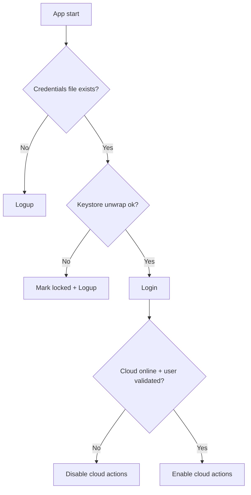

# Next Implementations: Hybrid A+B and Cloud Gating

Date: 2026-04-11

## Goals
- Harden "user exists" detection without breaking offline-first intent.
- Prevent data loss on transient keystore failures (no purge).
- Keep cloud actions visible but disabled when not available or user not validated.

## Hybrid A+B (Local + Advisory Cloud)
### Local (A): Usable credentials check
- Add a non-destructive check that attempts to unwrap the credentials blob using the Android Keystore wrapper.
- If unwrap succeeds: credentials are usable.
- If unwrap fails: mark as locked, do not delete data.

### Cloud (B): Advisory validation
- When online and verified, perform best-effort cloud presence checks.
- Never block local login/usage if cloud fails.

## Lock / Quarantine Behavior
- Create a lock marker file `credentials.locked` in `data/authentication/`.
- On unwrap failure: set lock marker.
- On successful unwrap or new sign-up: clear lock marker.
- Never purge automatically; allow retry later.

## UI Behavior
- Logup screen shows a warning banner when credentials are locked.
- A "Retry unlock" button re-attempts local validation.
- Cloud actions remain visible but disabled if:
  - Cloud is offline, or
  - User is not validated.

## Cloud Enablement Rule
`cloudReady = cloudState.isOnline && cloudState.isUserValidated`

Used to disable:
- Cloud upload buttons in Summary screens.
- Cloud download buttons in Field/Request screens.
- Cloud send method cards in Summary screens.

## Files to Update
- `app/src/main/java/com/shary/app/core/domain/interfaces/security/CryptographyManager.kt`
- `app/src/main/java/com/shary/app/infrastructure/security/manager/CryptographyManagerImpl.kt`
- `app/src/main/java/com/shary/app/core/domain/interfaces/persistance/CredentialsStore.kt`
- `app/src/main/java/com/shary/app/infrastructure/persistance/credentials/FileCredentialsStore.kt`
- `app/src/main/java/com/shary/app/infrastructure/security/helper/SecurityUtils.kt`
- `app/src/main/java/com/shary/app/core/domain/interfaces/states/CloudState.kt`
- `app/src/main/java/com/shary/app/infrastructure/services/cloud/CloudServiceImpl.kt`
- `app/src/main/java/com/shary/app/infrastructure/security/auth/AuthenticationServiceImpl.kt`
- `app/src/main/java/com/shary/app/core/domain/interfaces/navigator/EntryPoint.kt`
- `app/src/main/java/com/shary/app/ui/screens/home/utils/AppNavigator.kt`
- `app/src/main/java/com/shary/app/ui/screens/logup/LogupScreen.kt`
- `app/src/main/java/com/shary/app/ui/components/ReviewComponents.kt`
- `app/src/main/java/com/shary/app/ui/components/SharyButtons.kt`
- `app/src/main/java/com/shary/app/viewmodels/communication/CloudViewModel.kt`
- `app/src/main/java/com/shary/app/ui/screens/field/FieldScreen.kt`
- `app/src/main/java/com/shary/app/ui/screens/request/RequestScreen.kt`
- `app/src/main/java/com/shary/app/ui/screens/summary/SummaryFieldScreen.kt`
- `app/src/main/java/com/shary/app/ui/screens/summary/SummaryRequestScreen.kt`

## Mermaid Diagram (Flow)

