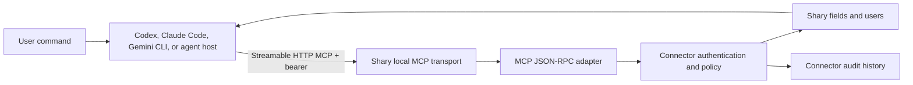

# Shary local-agent MCP design

## 1. Scope

This architecture targets developer and agent tools that support configurable
MCP servers:

- Codex.
- Claude Code.
- Gemini CLI.
- Other desktop or Android agent hosts with Streamable HTTP MCP support.

Consumer AI applications, cloud relays, Shary-owned chat interfaces, and
Android partner IPC are out of scope.

This document describes the implemented Android-local endpoint and its
development/test usage. Desktop production transport without ADB is defined in
`docs/architecture/SHARY_DESKTOP_BRIDGE_DESIGN.md`.

## 2. Objective

Expose Shary through a private local MCP endpoint while retaining Shary's
existing connector core as the only boundary for:

- bearer authentication;
- capability checks;
- confirmation;
- idempotency;
- audit;
- expiry and revocation.

The MCP adapter must not access repositories directly.

## 3. Architecture



Endpoint:

```text
http://127.0.0.1:8765/mcp
```

When the agent runs on the same Android device, no ADB forwarding is required.
When it runs on a desktop and Shary runs on Android, ADB forwarding remains the
development transport. It is not the production desktop connection.

## 4. Transport profile

Shary uses stateless request/response Streamable HTTP:

- `POST /mcp` accepts JSON-RPC.
- `GET /mcp` returns `405` because SSE is not implemented.
- `DELETE /mcp` returns `405` because Shary does not issue HTTP MCP sessions.
- The server binds only to `127.0.0.1`.
- Browser origins must be local.
- `Content-Type` must be `application/json`.
- `Accept`, when present, must permit `application/json`.
- `MCP-Protocol-Version`, when present, must match Shary's supported version.
- Responses declare the selected protocol version and `Cache-Control:
  no-store`.
- Request headers are interpreted case-insensitively.
- Request headers and bodies have bounded sizes.

This deliberately avoids SSE and server-initiated notifications until a
supported agent client requires them.

## 5. Agent discovery and setup

Agent clients discover Shary through their own MCP configuration. Shary does
not attempt to modify another application's configuration.

The operator flow is:

1. Start MCP in **Settings > Assistant Connectors**.
2. Pair a read-only or read-write connector.
3. Copy the short-lived bearer token.
4. Configure the agent with:
   - URL `http://127.0.0.1:8765/mcp`;
   - bearer-token environment variable;
   - prompt-based approval for writes.
5. Verify `initialize`, `tools/list`, and `ping`.

Future setup improvement: replace copied bearer tokens with a one-time local
pairing code. This is not required for the current implementation slice.

## 6. Tools and policy

Current tools:

- `shary.fields.list`
- `shary.fields.create`
- `shary.fields.update`
- `shary.users.list`
- `shary.users.create`
- `shary.users.update`
- `shary.actions.preview`
- `shary.actions.commit`

Mutation requirements:

- Every mutation has a unique `idempotency_key`.
- Strict-policy writes require `confirm=true`.
- Multi-item mutations should use preview then commit.
- Clients must inspect `result.isError`; HTTP `200` does not imply tool
  success.

## 7. Security requirements

- Bind only to loopback.
- Reject non-local `Origin` values before parsing tool calls.
- Authenticate every `tools/call`.
- Keep public protocol operations limited to initialization, ping, and tool
  discovery.
- Never log bearer tokens or field values.
- Keep stop and revoke as separate controls.
- Expiry and revocation invalidate subsequent calls.
- Rate limiting and vault-lock lifecycle enforcement remain the next security
  slice.

Field reads currently include values. Agents must be treated as trusted secret
consumers. A future capability split between field metadata and field values
is recommended before granting broad read access.

## 8. Implemented slice

The first transport-hardening slice provides:

1. A testable HTTP transport layer separated from the socket loop.
2. Case-insensitive header handling.
3. Local-origin validation.
4. JSON content-type and response-acceptance checks.
5. MCP protocol-version validation and response headers.
6. Explicit stateless `GET` and `DELETE` behavior.
7. A 1 MiB request-body limit and 16 KiB header limit.
8. Focused JVM tests for transport behavior.

## 9. Next implementation order

1. Implement the production desktop bridge phases in
   `SHARY_DESKTOP_BRIDGE_DESIGN.md`.
2. Add vault-lock and foreground-service lifecycle enforcement.
3. Add per-connector request rate limits.
4. Split field metadata and value-read capabilities.
5. Add a same-device Android MCP conformance client.
6. Add SSE only if a target agent client requires it.

## 10. Acceptance criteria

- Codex/Claude Code/Gemini CLI can initialize and discover tools.
- Lowercase HTTP headers work.
- Non-local origins are rejected.
- Unsupported protocol versions and media types fail before MCP dispatch.
- Oversized requests are rejected without allocating unbounded memory.
- Read-only connectors cannot write.
- Writes require idempotency and confirmation.
- Every allowed or denied tool operation appears in audit history.
- Existing protocol and real-agent E2E suites remain usable.

## 11. References

- [MCP Streamable HTTP transport](https://modelcontextprotocol.io/specification/2025-06-18/basic/transports)
- [OpenAI MCP documentation](https://developers.openai.com/codex/mcp)
- [Claude Code MCP documentation](https://code.claude.com/docs/en/mcp)
- [Gemini CLI MCP documentation](https://geminicli.com/docs/tools/mcp-server/)
