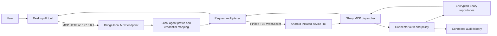

# Shary desktop bridge design

> Status: deferred alternative. The implemented production path uses the
> Firebase-hosted OAuth MCP gateway plus Android FCM/WorkManager execution,
> documented in `SHARY_REMOTE_MCP_OAUTH_DESIGN.md`. This bridge remains a
> possible LAN/offline transport, not the current rollout target.

## 1. Status and decision

Status: deferred alternative architecture.

The existing Android loopback MCP server plus `adb forward` is retained as a
development and conformance-test path. It is not the production desktop-agent
transport.

Production desktop access will use a small Shary Desktop Bridge:

```text
Desktop AI tool
    -> MCP on PC loopback
    -> Shary Desktop Bridge
    -> mutually authenticated encrypted device link over the local network
    -> Shary Android app
    -> existing connector authentication, policy, repositories, and audit
```

The bridge is not a desktop version of Shary. It is a transport adapter and
local credential broker. Shary Android remains the data owner and the only
authority for capabilities, confirmation, idempotency, audit, expiry, and
revocation.

## 2. Goals

1. Let desktop MCP clients use Shary without ADB, USB debugging, emulator
   networking, or manually exposed Android ports.
2. Keep the MCP endpoint on desktop loopback so Codex, Claude Code, and other
   local agent tools can use normal MCP configuration.
3. Keep field and user data on Android; the bridge must not maintain a Shary
   data replica.
4. Require explicit, visible pairing and allow immediate revocation from
   Shary.
5. Preserve the current connector capability and audit model.
6. Support offline local-network operation without a Shary cloud relay.

## 3. Non-goals

- A full desktop Shary application.
- Cloud-originated agents in the first production release.
- Internet exposure of the MCP endpoint or device-link listener.
- Silent background availability after reboot.
- Desktop-side policy decisions that can override Shary.
- SSE or server-initiated MCP notifications in the first release.

## 4. Architecture



### Desktop bridge responsibilities

- Bind the MCP endpoint only to `127.0.0.1`.
- Accept stateless MCP `POST` requests from configured local tools.
- Authenticate each local agent profile.
- Map a local profile credential to a Shary-issued connector session stored in
  the operating-system credential vault.
- Forward MCP requests over the active device link.
- Correlate responses, cancellations, timeouts, and disconnects.
- Provide a small tray/status UI for pairing, connection state, profile
  management, and diagnostics.
- Store no field values, user records, MCP payload logs, or audit replicas.

### Android responsibilities

- Scan and approve desktop bridge pairing.
- Persist the approved bridge identity using Android secure storage.
- Initiate and maintain the encrypted device link.
- Run the link through a user-visible foreground service while desktop access
  is enabled.
- Dispatch relayed MCP requests through `SharyMcpServer` and the existing
  connector core.
- Create, refresh, expire, and revoke connector sessions.
- Pause or deny access when Shary is locked or the user disables the link.
- Keep the authoritative audit history.

### Shared protocol responsibility

A transport-only shared module defines:

- pairing messages;
- link handshake messages;
- request/response envelopes;
- heartbeat and connection-state messages;
- error codes and version negotiation;
- bounded serialization rules.

It contains no repository, UI, or authorization logic.

## 5. Recommended repository modules

```text
:app
  Android UI, foreground service, device-link client, MCP dispatcher

:connector-link-protocol
  Kotlin/JVM serialization models and protocol validation shared by Android
  and desktop

:desktop-bridge
  Kotlin/JVM application with local MCP HTTP endpoint, TLS WebSocket listener,
  secure credential storage adapters, and tray UI
```

Kotlin/JVM is preferred for the first bridge because the repository already
uses Kotlin, coroutines, serialization, OkHttp, and Ktor-compatible patterns.
The desktop executable should be packaged independently; it must not require
Android Studio or the Android SDK.

## 6. Network model

### Desktop MCP side

- Default endpoint: `http://127.0.0.1:8765/mcp`.
- The endpoint never binds to a LAN or public interface.
- Each configured local agent profile has a random local bearer credential.
- Requests without a recognized profile credential are rejected locally.

### Device-link side

- The bridge listens on a configurable high TCP port on the private LAN.
- Shary Android initiates a `wss://` connection to that listener.
- QR pairing is authoritative; mDNS/NSD discovery may be added later only as a
  convenience.
- TLS certificate pinning prevents LAN interception with an untrusted
  certificate.
- The application handshake authenticates the previously paired Android and
  bridge identities.
- The link supports reconnect with bounded exponential backoff.

This arrangement requires a normal desktop firewall exception for the bridge,
but no Android debug mode, port forwarding, USB connection, or Android
listener exposed to the network.

## 7. Pairing protocol

### Bridge preparation

On first start, the bridge:

1. Generates a persistent bridge signing identity.
2. Generates a local TLS key and certificate.
3. Stores private material in the operating-system credential vault.
4. Creates a one-time pairing invitation with a short expiry.
5. Displays a QR code and a human-readable verification code.

The QR payload contains only:

- protocol version;
- bridge instance ID;
- candidate LAN address and port;
- TLS public-key fingerprint;
- one-time invitation ID and secret;
- expiry;
- bridge signing public key.

It contains no Shary connector token or vault data.

### Android approval

Shary:

1. Scans the QR code.
2. Connects to the bridge with the TLS fingerprint pinned.
3. Performs a nonce-based mutual challenge.
4. Shows the bridge name, desktop address, requested role, and matching
   verification code.
5. Requires explicit user approval.
6. Stores the bridge public identity and link metadata.
7. Sends its installation public identity to the bridge.
8. Invalidates the one-time invitation.

### Reconnection

Later connections require proof of both persistent identities. A copied QR
code cannot create a second pairing after the invitation is consumed or
expired.

Pairing and connector authorization are separate:

- bridge pairing authorizes a device transport;
- an agent profile authorizes a capability-scoped Shary connector session.

Revoking either one stops access.

## 8. Agent profile provisioning

The desktop bridge presents **Add agent profile** with:

- display name;
- read-only or read-write mode;
- intended local client;
- session duration.

Provisioning flow:

1. The bridge sends a profile request over the paired device link.
2. Shary displays the requested capabilities and expiry.
3. The user approves or denies it in Shary.
4. Shary creates the connector client and session using the existing connector
   use cases.
5. The Shary access token and refresh secret travel once through the encrypted
   device link.
6. The bridge stores them in the OS credential vault.
7. The bridge generates a separate random local bearer for the desktop agent.
8. The user configures the agent with the bridge loopback URL and local bearer.

The bridge replaces the local bearer with the Shary session bearer when
forwarding a request. This local mapping protects the loopback endpoint but
does not grant capabilities: Shary still evaluates every tool call.

Session refresh must be requested through Shary. The bridge cannot extend
expiry or change capabilities independently.

## 9. Device-link protocol

The first version uses a request/response WebSocket channel because Shary must
initiate the connection and the bridge must send later MCP requests back over
that established channel.

Envelope:

```json
{
  "version": 1,
  "type": "mcp_request",
  "link_id": "lnk_...",
  "request_id": "req_...",
  "sequence": 42,
  "created_at": 1781950000,
  "expires_at": 1781950030,
  "payload": {
    "method": "POST",
    "path": "/mcp",
    "headers": {},
    "body": "{}"
  }
}
```

Message types:

- `hello`
- `challenge`
- `challenge_response`
- `link_ready`
- `mcp_request`
- `mcp_response`
- `cancel`
- `heartbeat`
- `state_changed`
- `profile_request`
- `profile_result`
- `session_refresh`
- `session_revoked`
- `link_revoked`

Protocol rules:

- Maximum MCP body remains 1 MiB.
- Maximum link envelope size is bounded.
- Request IDs are unique per active link.
- Sequence numbers are monotonic and replayed values are rejected.
- Requests expire and are not executed after their deadline.
- Unknown versions or message types fail closed.
- Only a bounded number of requests may be in flight.
- Field values and bearer credentials are never logged.

TLS provides confidentiality and integrity. The authenticated application
handshake binds the TLS session to the paired bridge and Android identities.

## 10. Request flow

1. The local AI tool sends MCP HTTP to the bridge loopback endpoint.
2. The bridge authenticates the local profile and checks that its Shary
   session is usable.
3. The bridge replaces the local credential with the Shary bearer.
4. The bridge sends a bounded `mcp_request` over the active device link.
5. Android validates the envelope and deadline.
6. Android calls the existing raw MCP dispatcher.
7. `SharyMcpServer` delegates to the connector core.
8. Shary authenticates, evaluates policy, performs the operation, and records
   audit evidence.
9. Android returns the raw MCP response.
10. The bridge returns it to the local AI tool without storing the payload.

The bridge must preserve MCP `result.isError`. It must not translate a denied
Shary tool call into success.

## 11. Lifecycle and user experience

### Shary Settings

Add a **Desktop connections** section:

- `Pair desktop bridge`
- paired bridge list;
- connection state and last activity;
- `Connect` / `Disconnect`;
- foreground-service explanation;
- agent profile list with capabilities and expiry;
- per-profile revoke;
- bridge revoke;
- recent audit shortcut.

### Desktop bridge

Provide:

- pairing QR;
- Android connection state;
- profile list;
- MCP endpoint and copyable configuration;
- token rotation;
- diagnostics with metadata only;
- `Disconnect`, `Forget device`, and `Quit`.

### Android background behavior

- Desktop access is opt-in and visibly active.
- A foreground-service notification is shown while the device link is active.
- Locking Shary pauses sensitive tool calls.
- Logging out, revoking the bridge, or disabling desktop access closes the
  link.
- The bridge does not reconnect after reboot until the user-enabled policy
  allows it and Android lifecycle rules permit it.

## 12. Failure semantics

The bridge returns:

- HTTP `503` when no approved Android device is connected;
- HTTP `504` when a relayed request exceeds its deadline;
- HTTP `401` for an invalid local profile credential;
- HTTP `413` for oversized requests;
- the original MCP response for completed Shary calls.

Disconnecting during an uncertain mutation must not trigger an automatic
retry with a new idempotency key. The agent may safely retry only with the same
key.

## 13. Security model

### Protected assets

- Shary field values and user data;
- Shary connector access and refresh credentials;
- paired bridge and Android identities;
- audit integrity;
- mutation confirmation and idempotency state.

### Primary threats and controls

| Threat | Control |
|---|---|
| LAN interception | Pinned TLS plus authenticated application handshake |
| Rogue bridge | Explicit QR pairing, verification code, persistent identity |
| Replayed pairing invite | One-time secret, short expiry, consumed state |
| Rogue local process | Loopback-only endpoint plus per-profile local bearer |
| Bridge compromise | Capability-scoped Shary session, short expiry, revoke, no data replica |
| Stolen desktop credential store | OS vault, session expiry, Android-side revoke |
| Replayed mutation | Existing idempotency keys and link sequence validation |
| Background secret access | Foreground service, vault-state enforcement, visible controls |
| Data leakage through logs | Metadata-only diagnostics and secret-value redaction |
| Resource exhaustion | Body limits, in-flight limits, rate limits, deadlines |

A compromised authorized bridge can exercise its granted capabilities until
the profile expires or is revoked. This is the same trust class as a
compromised authorized MCP client and must be stated clearly during pairing.

## 14. Alternatives considered

### Expose Shary directly on the LAN

Rejected for production. It makes Android the inbound server, complicates
background lifecycle and discovery, and expands the device attack surface.

### Keep ADB forwarding

Retained for development only. It requires debug tooling and is not an
end-user transport.

### Build a full Shary desktop application

Rejected for this capability. It duplicates product UI, persistence, and
security responsibilities that the bridge does not need.

### Use a public cloud relay first

Deferred. It supports remote and cloud-hosted agents but changes Shary's
privacy, identity, operations, and cost boundary. The local bridge should be
completed before considering it.

### Run the AI tool on Android

Valid for compatible local clients, but it does not solve desktop Codex,
Claude Code, or other workstation-agent workflows.

## 15. Implementation phases

### Phase 0: connector boundary preparation

Status: implemented on 2026-06-20.

1. Extracted `SharyMcpDispatcher` from the current socket server while keeping
   `SharyMcpServer` as a compatibility facade.
2. Added fail-closed vault/authentication state enforcement for tool calls.
3. Added bounded per-bearer request rate limits with stable MCP tool errors.
4. Kept the current localhost transport behavior and focused tests passing.

### Phase 1: desktop bridge skeleton

Status: next implementation phase.

1. Add `:connector-link-protocol`.
2. Add `:desktop-bridge`.
3. Implement loopback MCP, fake-device transport, request correlation, limits,
   and desktop unit tests.
4. Package a Windows development executable.

### Phase 2: secure Android device link

1. Implement QR pairing and bridge identity storage.
2. Implement pinned TLS WebSocket connection.
3. Add the Android foreground service and reconnect policy.
4. Relay public MCP operations through the real device link.

### Phase 3: agent profiles

1. Add Android approval UI.
2. Provision connector sessions through existing use cases.
3. Add OS-vault credential storage and local bearer mapping.
4. Support read-only and read-write profiles, refresh, expiry, and revoke.

### Phase 4: production hardening

1. Add rate, concurrency, timeout, replay, and malformed-message tests.
2. Add lock/logout/revoke lifecycle tests.
3. Add installer signing, firewall guidance, upgrade compatibility, and
   structured diagnostics.
4. Complete real Codex/Claude E2E without ADB.

### Phase 5: optional reach expansion

Evaluate an encrypted relay only if remote or cloud-hosted agent demand
justifies the additional privacy and operational boundary.

## 16. Validation matrix

| Layer | Required evidence |
|---|---|
| Shared protocol | Serialization, version, size, replay, deadline tests |
| Bridge MCP | Initialize, discovery, reads, writes, errors, timeout tests |
| Pairing | QR expiry, wrong fingerprint, wrong code, replay, revoke tests |
| Device link | Reconnect, heartbeat, cancellation, bounded concurrency tests |
| Shary policy | Read-only denial, confirmation, idempotency, audit tests |
| Persistence | Create/update followed by independent read after reconnect |
| Lifecycle | Vault lock, logout, process death, reboot, bridge shutdown tests |
| Security | Secret-log scan, LAN interception rejection, local auth rejection |
| Real agent | Codex and Claude read/write E2E with no ADB process installed |

## 17. Production acceptance criteria

1. A non-developer installs the bridge without Android SDK or ADB.
2. Shary pairs to it by QR on the same private network.
3. A desktop MCP client initializes and discovers all Shary tools.
4. Read-only and read-write profiles enforce distinct capabilities.
5. Created and updated data remains readable after link reconnect.
6. Preview/commit remains idempotent across a transient disconnect.
7. Vault lock, connector revoke, and bridge revoke stop subsequent calls.
8. The desktop stores no Shary data replica and emits no secret-bearing logs.
9. The MCP endpoint is unreachable from another LAN host.
10. The complete E2E suite passes with ADB absent from the desktop.

## 18. References

- [MCP Streamable HTTP transport](https://modelcontextprotocol.io/specification/2025-06-18/basic/transports)
- [Android Network Service Discovery](https://developer.android.com/develop/connectivity/wifi/use-nsd)
- [Android foreground services](https://developer.android.com/develop/background-work/services/fgs)
