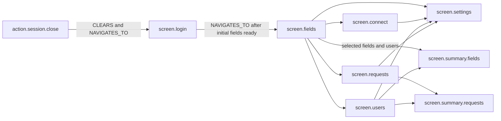
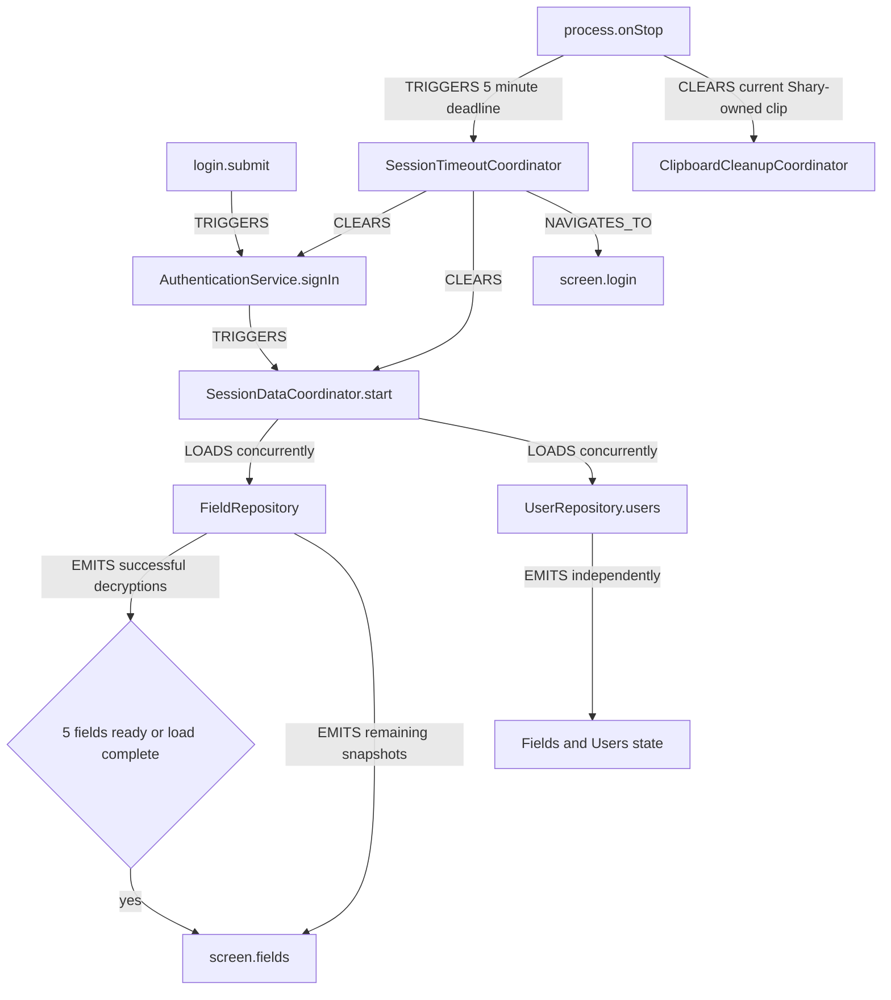
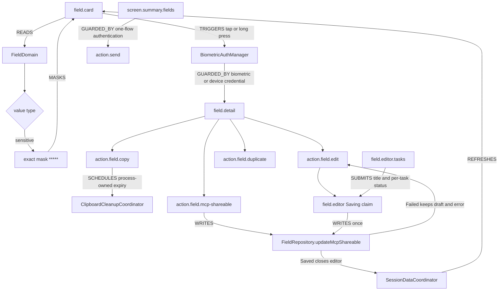
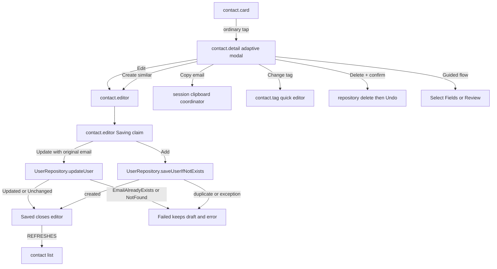
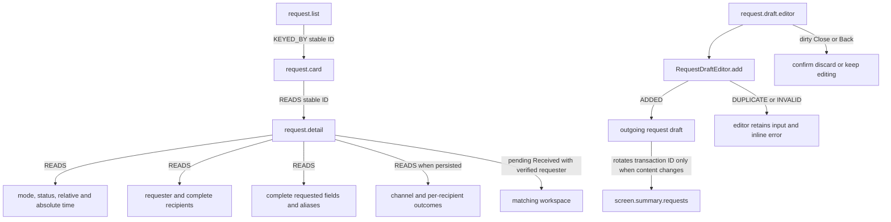
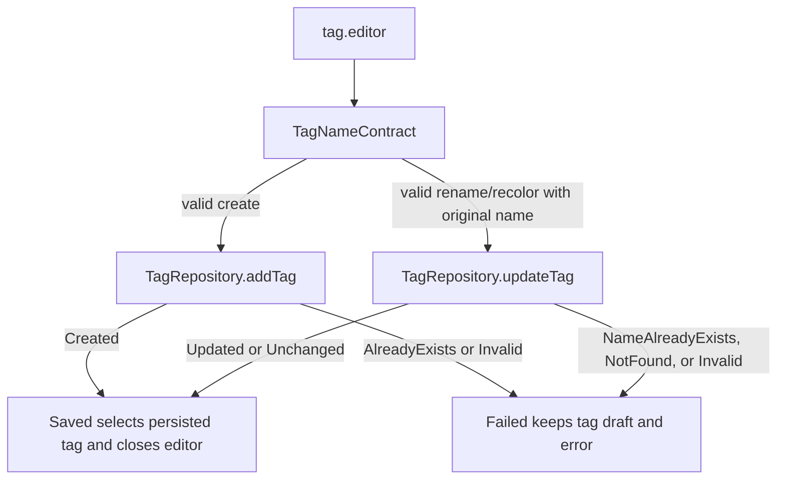
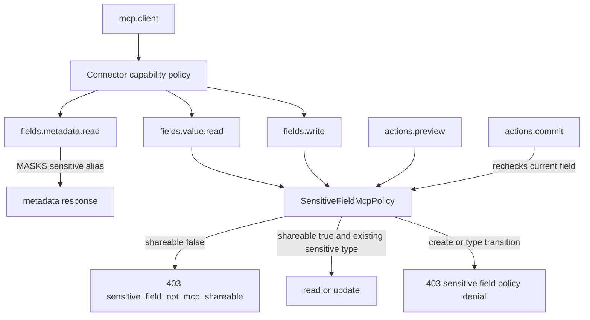
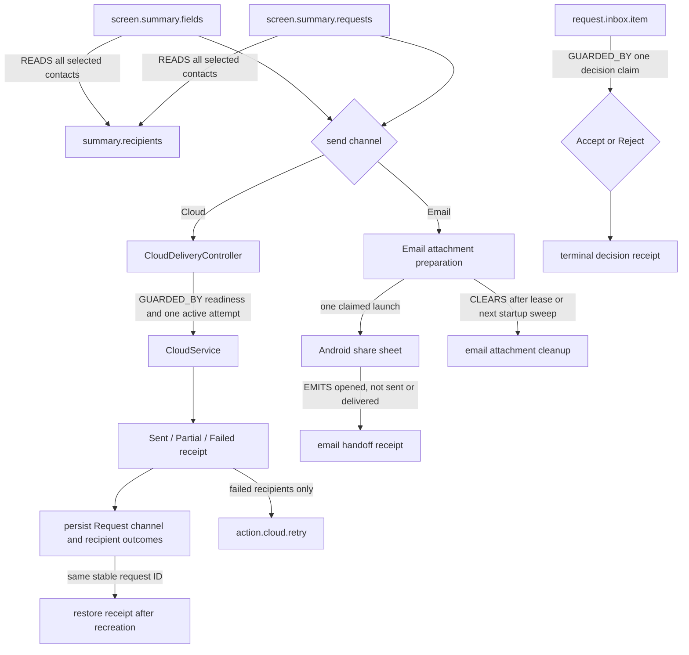

# Shary Element and Action Map

Development-only map for quickly tracing visible elements, actions, guards,
state, and owning application components. This document is not rendered in the
app.

## Relation Vocabulary

| Relation | Meaning |
|---|---|
| `CONTAINS` | A screen or component owns a visible child element. |
| `TRIGGERS` | A user or agent action invokes behavior. |
| `READS` | An element or action consumes state. |
| `WRITES` | An action changes repository or session state. |
| `NAVIGATES_TO` | An action changes the active route. |
| `GUARDED_BY` | An action requires policy, confirmation, or authentication. |
| `EMITS` | A state owner publishes a result or event. |
| `REFRESHES` | A mutation causes shared state to reload. |
| `CLEARS` | An action removes ephemeral or authenticated state. |
| `MASKS` | A policy replaces protected content with a safe representation. |
| `LOADS` | A coordinator retrieves or decrypts data. |

## Application Navigation

## Login, Loading, and Session

## Fields and Sensitive Access

## Contacts and Editor Outcomes

## Requests and Draft Editor Outcomes

## Tag Editor Outcomes

## MCP Field Policy

## Review Delivery and Inbox Decisions

## Edge Index

| Source ID | Relation | Target ID | Guard / condition | Primary owner |
|---|---|---|---|---|
| `login.submit` | `TRIGGERS` | `session.data.start` | Local authentication succeeds | `AuthenticationViewModel` |
| `session.data.start` | `LOADS` | `field.repository` | Session is authenticated | `SessionDataCoordinator` |
| `session.data.start` | `LOADS` | `user.repository` | Non-blocking | `SessionDataCoordinator` |
| `field.initial.snapshot` | `NAVIGATES_TO` | `screen.fields` | Five successes or load complete | `LoginScreen` |
| `field.card.tap` | `GUARDED_BY` | `device.authentication` | Sensitive type only | `FieldsScreen` |
| `field.card` | `MASKS` | `field.value`, `field.alias` | Sensitive and not authorized | `FieldValueTypes` |
| `field.detail.mcp-toggle` | `WRITES` | `field.isMcpShareable` | Authenticated detail flow | `FieldViewModel` |
| `contact.editor.update` | `WRITES` | `contact.repository` | Original email exists and updated email does not collide | `UserViewModel`, `UserRepositoryImpl` |
| `contact.tag.update` | `WRITES` | `contact.repository` | Target email exists | `UserViewModel`, `UserRepositoryImpl` |
| `contact.tag.create` | `WRITES` | `contact.tag.repository` | Shared validation passes and case-insensitive name is unique | `ContactTagViewModel`, `ContactTagRepositoryImpl` |
| `request.card` | `READS` | `request.detail` | Stable Request ID survives reorder and configuration recreation; detail discloses only persisted status/history | `RequestScreen`, `RequestDetailDialog` |
| `request.draft.editor` | `WRITES` | `outgoing.request.draft` | Saveable dirty draft; only `ADDED` dismisses, while duplicate or invalid input remains visible | `AddRequestDialog`, `RequestDraftEditor`, `RequestViewModel` |
| `request.workflow.draft` | `PERSISTS` | `owner.request.workflow` | Minimal identities only; owner match and vault codec required for restore | `RequestRepositoryImpl`, `RequestViewModel` |
| `tag.editor.create` | `WRITES` | `tag.repository` | Shared validation passes and case-insensitive name is unique | `TagViewModel`, `TagRepositoryImpl` |
| `tag.editor.update` | `WRITES` | `tag.repository` | Original name exists and target name does not collide | `TagViewModel`, `TagRepositoryImpl` |
| `summary.fields.send` | `GUARDED_BY` | `device.authentication` | Selection contains sensitive field | `SummaryFieldScreen` |
| `summary.recipients` | `READS` | `selected.contacts` | Every selected recipient is disclosed | `SummaryFieldScreen`, `SummaryRequestScreen` |
| `summary.cloud.send` | `GUARDED_BY` | `cloud.delivery.claim` | Cloud ready and no active or terminal ordinary send | `CloudDeliveryController` |
| `summary.cloud.retry` | `TRIGGERS` | `cloud.delivery` | Failed recipients only; request retry keeps transaction ID | `CloudDeliveryController` |
| `cloud.delivery.receipt` | `PERSISTS` | `request.delivery.history` | Outgoing Requests and received responses; channel, update time, and every recipient result | `RequestRepository` |
| `summary.email.share` | `EMITS` | `email.share-sheet-opened` | Does not prove sending or delivery | `EmailShareController` |
| `email.attachment.cleanup` | `CLEARS` | `email.attachment` | 24-hour live-process lease or next-start expired sweep | `EmailAttachmentCleanupCoordinator` |
| `field/contact.copy` | `SCHEDULES` | `clipboard.cleanup` | Process-owned timer; sensitive Field clips are marked | `ClipboardCleanupCoordinator` |
| `process.background` | `CLEARS` | `clipboard.current` | Only when the current clip still carries Shary's ownership token | `ClipboardCleanupCoordinator` |
| `request.inbox.decision` | `GUARDED_BY` | `request.decision.claim` | One item/decision; ambiguous failure retries the same decision only | `RequestInboxDecisionController` |
| `mcp.fields.get` | `GUARDED_BY` | `sensitive.policy` | Capability plus per-field flag | `LoopbackConnectorRouter` |
| `mcp.actions.commit` | `GUARDED_BY` | `sensitive.policy` | Rechecked at commit time | `CommitConnectorActionsUseCase` |
| `process.background` | `TRIGGERS` | `session.deadline` | Process lifecycle stop | `SessionTimeoutCoordinator` |
| `session.deadline` | `CLEARS` | `auth/cache/session-data` | Five minutes elapsed | `SessionTimeoutCoordinator` |

## Maintenance Check

Update this map when a screen gains or removes a primary action, navigation
changes, a security guard moves, a new field type changes rendering or sharing,
or startup/session ownership changes. Keep IDs stable when behavior is renamed
but its responsibility remains the same.
